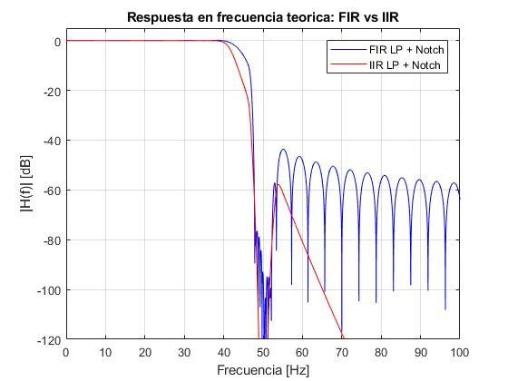
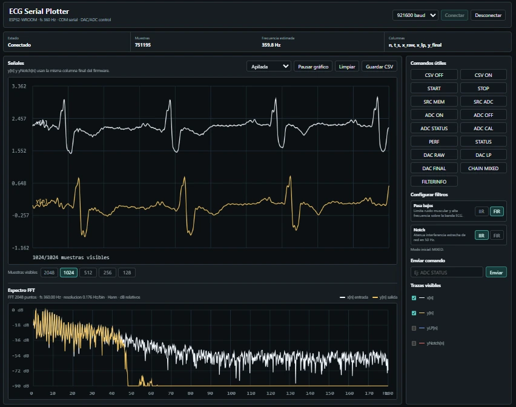

**Nicolás Fontana · Nicolás Molo · Malena Silvestre** · Técnicas Digitales III · UTN Facultad Regional Paraná · 2026.

## Academic Coursework · Digital Techniques III

To reduce high-frequency noise and mains interference, the team applied two cascades to record 118e00 from the MIT-BIH Noise Stress Test Database at 360 samples/s. MATLAB simulations compared a Kaiser low-pass and a Hamming band-stop FIR with Butterworth IIR alternatives. Tests covered impulse response, phase, group delay and signal FFT.

Figure 26, report p. 42. These curves describe transfer functions. A finite-record FFT measures the change in the processed signal spectrum.

## Results and design trade-off

The symmetric FIR stages have linear phase. Orders of 81 and 720 give a total delay of 400.5 samples, or 1.1125 s. The report finds lower RMSE for FIR in this trial and lower computational cost for IIR. The technical review distinguishes the second-order IIR example from the final order-22 low-pass design.

## From simulation to the bench

A rule-based expert system weighs phase, memory, noise and latency. The ESP32 bench test pairs a FIR low-pass with an IIR notch. A Web Serial app displays stored ECG samples and their spectrum. The report also documents a sine-wave test on the ADC. The evidence covers simulation and bench testing.

Figure 33, p. 61. Results from the course report, pp. 31–61.
