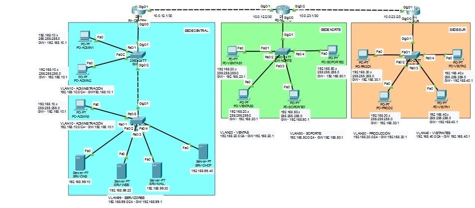

**Nicolás Fontana · Nicolás Molo · Malena Silvestre** · Técnicas Digitales III · UTN Facultad Regional Paraná · 2026.

## Design problem

Each department needs a separate network, while all three offices rely on servers at Central. The team built a linear topology in Cisco Packet Tracer with three Cisco 2911 routers, four 2960 switches, eleven PCs and four servers. Traffic from Central to South crosses North.

Network report, p. 5. Lab access details were removed.

## From access port to application

Access ports separate Administration, Sales, Support, Production, Visitors and Servers. IEEE 802.1Q trunks carry each site's VLANs to router subinterfaces. Single-area OSPFv2 advertises six LANs and two transit networks. DHCP relay serves five user VLANs from one server. The server VLAN also hosts DNS, HTTP, SMTP and POP3.

## Verification and recovery

The team checked VLAN and trunk membership, OSPF neighbours and routes before testing connectivity, web access and email. Simulation Mode exposed DHCP exchanges and the DNS–TCP–HTTP sequence. Disabling DHCP prevented a new lease. Changing an A record produced a valid DNS reply with the wrong destination. The report documents service restoration (pp. 20–40). These results describe the simulated network.
