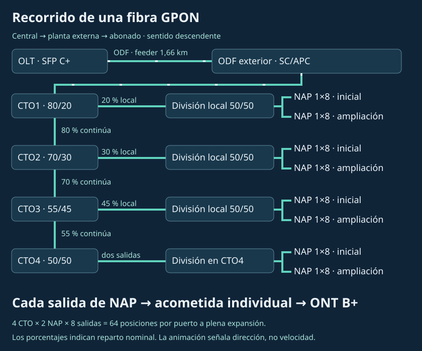
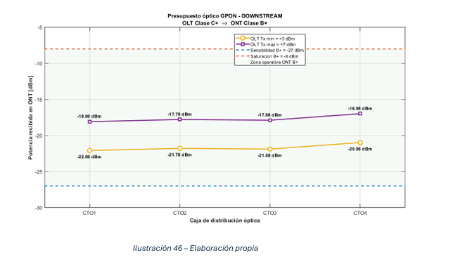
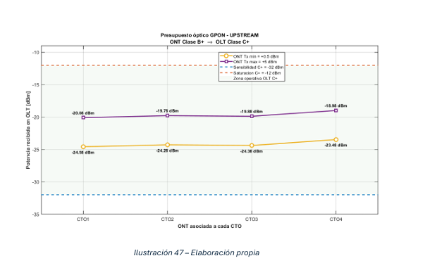

An eight-block survey identified **223 homes and 23 businesses or warehouses** in Paraná. Existing aerial infrastructure already carried copper, coaxial cable and fibre. This academic project by Nicolás Nahuel Fontana at UTN Facultad Regional Paraná explores how to serve those premises through underground ducts.

**Design objectives.** Size the network for staged take-up, decide how much optical power to tap at each terminal and verify the receiver limits in both directions.

[Network architecture](#network-architecture) · [Deployment method](#deployment-method) · [Optical power budget](#optical-power-budget) · [Conclusions](#conclusions) · [Sources](#sources)

## Network architecture

The central office uses a TP-Link DS-P7001-08 OLT with eight GPON ports. Each active port uses a DS-PMA-C+ optical module. A 1.66 km, 12-fibre feeder connects the SC/UPC central distribution frame to the SC/APC distribution point. Subscriber equipment is the TP-Link XC220-G3v V2 ONT, modelled as class B+.

| Terminal | Power passed to the next terminal | Local distribution |
|---|---:|---|
| CTO1 | 80% | 20% to a local 50/50 splitter |
| CTO2 | 70% | 30% to a local 50/50 splitter |
| CTO3 | 55% | 45% to a local 50/50 splitter |
| CTO4 | End of feeder cascade | One terminal 50/50 splitter |

Each local 50/50 splitter feeds two eight-way network access points (NAPs), one for initial service and one for expansion. The percentages apply to the power entering each splitter. The budget uses the insertion loss of the specific output traversed by the signal.

## Deployment method

Round the projected subscriber count up, then divide by 64 and round up again to obtain the minimum number of active GPON ports.

| Take-up assumption | Subscribers | Minimum active ports |
|---|---:|---:|
| 40% | 99 | 2 |
| 70% | 173 | 3 |
| 100% | 246 | 4 |

Plan the shared ducts and chambers for full coverage before equipping individual branches. At 40% take-up, activating just one eight-way NAP at each of four terminals on two ports provides only 64 outlets for 99 subscribers. The locations of the first connections therefore determine which expansion NAPs must be fitted.

The preliminary underground design calls for 29 main chambers, 112 secondary chambers, 5,000 m of main duct, 560 m of microduct and 32 service pillars. Main chambers provide access at changes of direction and branch points. Secondary chambers serve groups of premises. Detailed routing would require utility surveys, crossing details and local permits.

## Optical power budget

Received power in dBm equals transmitted power in dBm minus path loss in dB. The study assigns 1 dB to each of two distribution connections, 0.58 dB to the feeder (1.66 km at 0.35 dB/km), 3.6 dB to a 50/50 output, 11 dB to an eight-way output and 0.5 dB to the final connection. The asymmetric splitters add 1.3/7.4 dB (80/20), 1.9/5.8 dB (70/30) and 3.1/4.0 dB (55/45), respectively.

| Path | Loss (dB) | Downstream at ONT, min / max (dBm) | Upstream at OLT, min / max (dBm) |
|---|---:|---:|---:|
| CTO1 | 25.08 | −22.08 / −18.08 | −24.58 / −20.08 |
| CTO2 | 24.78 | −21.78 / −17.78 | −24.28 / −19.78 |
| CTO3 | 24.88 | −21.88 / −17.88 | −24.38 / −19.88 |
| CTO4 | 23.98 | −20.98 / −16.98 | −23.48 / −18.98 |

### Downstream

CTO1 has the lowest received power at −22.08 dBm, giving 4.92 dB above the ONT sensitivity of −27 dBm. CTO4 comes closest to the −8 dBm overload threshold with 8.98 dB of headroom.

### Upstream

The receiver is now the OLT. At minimum launch power, CTO1 gives 7.42 dB above its −32 dBm sensitivity. At maximum launch power, CTO4 gives 6.98 dB below the −12 dBm overload threshold. The final branch has less loss because it avoids a local asymmetric tap.

Two differences from the submitted report are retained for traceability. Recalculating the CTO3 upstream minimum gives −24.38 dBm and 7.62 dB of sensitivity margin (report pp. 52 and 54). For CTO4, −12 − (−18.98) gives 6.98 dB of overload headroom (p. 56). The figures plot the calculated receiver levels in MATLAB.

## Conclusions

Four active ports provide 256 planned outlets for 246 potential premises at full take-up. Across the four paths and both directions, the smallest calculated margin is **4.92 dB**, which exceeds the project's 3 dB reserve by **1.92 dB**. The model uses one feeder attenuation coefficient for both wavelengths and omits the short distances between terminals. Field evidence covers the visual survey of existing infrastructure. Acceptance of a built network would require as-built lengths and optical measurements on each path.

## Sources

The primary source is Nicolás Nahuel Fontana’s *Red de acceso telefónica*, Telephony coursework at UTN Facultad Regional Paraná. Pages 6–28 cover the survey and sizing, pp. 29–41 describe equipment and topology, pp. 42–57 give the budget and plots, and pp. 57–72 cover underground routing and phased expansion. The teaching unit *Unidad 4 – FTTH* explains the link budget (PDF p. 120) and passive distribution components (pp. 128–131).

The report relates ITU-T L.250 and G.984.1 to topology and GPON architecture, G.984.2 to optical interfaces and IEC 60794-3-10 to outdoor cable. L.155, L.205, L.258 and L.259 inform the underground infrastructure discussion. The split ratios and reserve are project design choices. [Technical references and their applications (Spanish)](https://github.com/NicolasFontana-creator/ftth-gpon-network-design/blob/main/docs/referencias.md)
