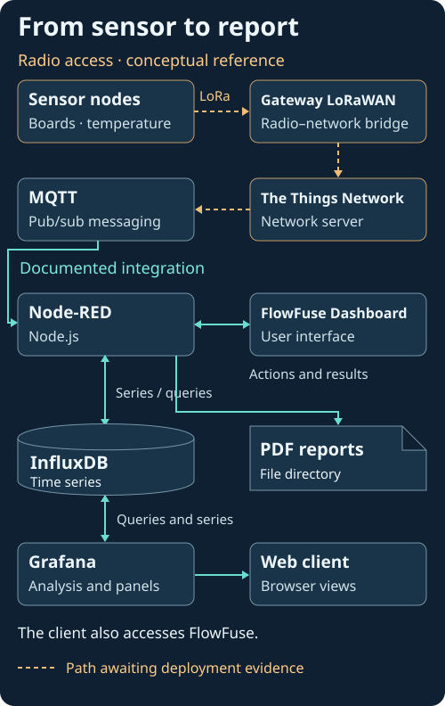
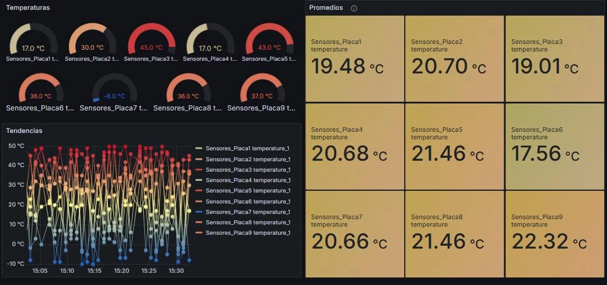
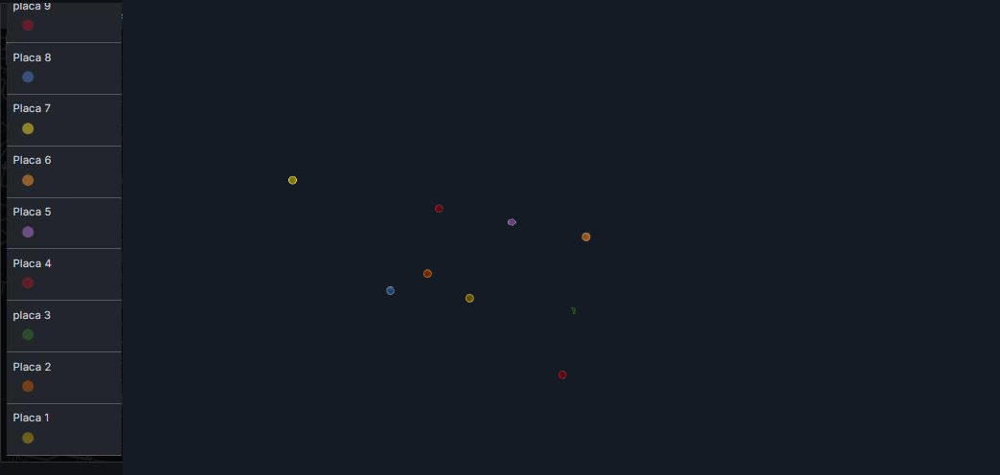
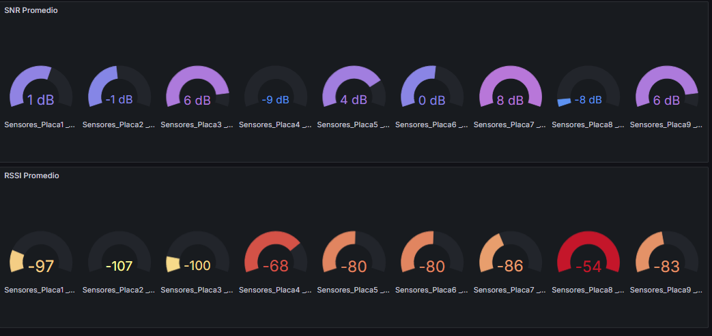

**Nicolás Nahuel Fontana · Telecommunications Laboratory, UTN Facultad Regional Paraná.**

To study resource management in smart cities, the laboratory brought readings from nine boards, signal quality and device locations into one platform. An operator can inspect an update, retrieve earlier samples and preserve an observation in a report.

## Processing and storage

Node.js provides the backend runtime. Node-RED connects MQTT events with FlowFuse Dashboard and InfluxDB time series. An incoming event updates the corresponding sensor card. Independently, the dashboard queries stored readings once a minute for statistics.

## Dashboards and queries

FlowFuse shows the latest temperature per board and the Cold, Normal and Hot states. Indicators include mean, extremes and spread of temperature, RSSI in dBm and SNR in dB. Operators select a board and time range for historical queries. Grafana queries InfluxDB for temperature, location and radio panels.

Figure 2 · Nine temperature cards with their recorded states.

Historical dashboard capture. The example retrieves ten minutes of readings from one board, whereas the temperature and radio indicators query the database once a minute.

## Grafana

These screenshots come from the report. The basemap was removed to show relative positions while protecting site locations.

Figure 13 · Temperature and trends in Grafana.

Figure 14 · Relative device positions; basemap removed.

Figure 15 · SNR and RSSI panels in Grafana.

## Device reports

From the dashboard, the operator selects a device and application, enters observations and saves the report. The platform keeps the PDF in a directory, with the device and timestamp in its filename.

## Results and future work

The report confirms functional integration of the software tools. Screenshots record the state of the trial. No latency, availability or energy measurements were reported. RStudio, predictive analysis and improved handling of large data volumes are future work.
