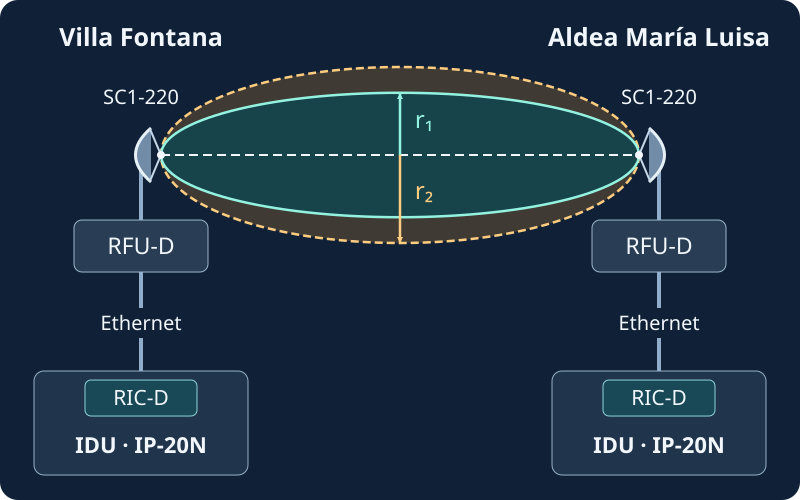
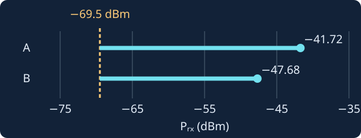

**Nicolás Fontana and Juan Andrés Terlin** · Microwave Equipment · Electronic Engineering, UTN Facultad Regional Paraná · 2026.

## Problem and objectives

Can a **5.88 km** hop carry **155 Mbit/s** between Villa Fontana and Aldea María Luisa with trees along the path? The project investigates antenna mounting heights, the modulation needed for the target throughput and the margin available for propagation losses. The authors visited the sites. Received power, fade margin and availability are design estimates.

## From field survey to path profile

The field survey, the IGN *General Racedo* map at 1:50,000 and Google Earth identified changes in elevation, watercourses and vegetation. The worksheet gives bearings of **66° 24′ 02″** from Villa Fontana and **246° 22′ 13″** in the reverse direction. The adopted antenna heights are **23 m and 12 m** above ground, respectively (report, pp. 3–18).

Trees at the obstacle 2.44 km along the path were estimated to be 20 m tall. The study compares the ray path with terrain, vegetation and Earth curvature at effective Earth radius factors **k = 4/3 and k = 2/3**. It reports radii of **4.4 m** and **6.22 m** for the first and second Fresnel zones. The appendix uses **6.15 km and 23 GHz** in these equations and starts with a **25 m** southern antenna to derive the other height. Final clearance remains open until those inputs are reconciled with the adopted profile (pp. 16–18 and 41–43).

## Communications architecture and equipment

At each site, a **Ceragon FibeAir IP‑20N** indoor unit uses a **RIC‑D** interface card to communicate with an outdoor **RFU‑D**. The indoor–outdoor connection carries digital data. The RFU performs modulation and couples to a **0.30 m RFS SC1‑220** antenna. The budget assumes **35.5 dBi** per antenna and direct mounting. Mechanical compatibility depends on the antenna variant and adapter (pp. 34–38 and 43–51).

Follow the diagram from the Villa Fontana IDU to the Aldea María Luisa IDU. The RIC-D card connects each access node to its RFU-D over Ethernet. Between the SC1-220 antennas, the dashed line marks the line of sight. The arrows r₁ and r₂ show the radii to the first and second Fresnel boundaries at mid-path. The diagram is schematic and drawn without scale.

The design allows **35 m of copper cable at each site**, with fibre as an alternative. Data cable attenuation is evaluated separately from microwave path loss. The installation drawings cover shelter, outdoor cabinet, rack and grounding proposals (pp. 23–38 and 51–56).

## Channel selection and RF link budget

The assigned coursework frequencies of **21.462 / 22.694 GHz** are **1,232 MHz** apart. The design uses channel 9 at **28 MHz** under the arrangement studied in ITU‑R F.637‑5. Table 7 gives **167–205 Mbit/s** for **128‑QAM**. The link budget assumes **22 dBm** transmit power and **−69.5 dBm** receiver sensitivity at a BER of 10⁻⁶ (pp. 19, 22 and 43–49).

**A · Analytical calculation.** At the mean frequency of 22.078 GHz, free-space loss is **134.72 dB**. Adding antenna gains to transmit power and subtracting this loss gives **22 + 35.5 + 35.5 − 134.72 = −41.72 dBm**. The resulting margin above sensitivity is **27.78 dB** (p. 19).

**B · Final worksheet.** The worksheet includes **6.02 dB of obstruction loss** and reports **−47.68 dBm** received power and **21.82 dB** fade margin. The figure reconstructs both results from pp. 19 and 22. The worksheet locates an obstacle at 0.30 km while the survey table places the first obstacle at 0.03 km. Their positions must be reconciled before assigning the loss to a specific obstruction.

## Conclusions and scope

The selected modulation meets the throughput target in the report’s capacity table. Including obstruction reduces the worksheet margin. The analytical rain model estimates **24.46 dB** of attenuation exceeded for **0.01%** of the time. The worksheet uses different coefficients and reports a total exceedance of **0.126476%** before diversity improvement. The probability units in the analytical availability calculation also need review. **99.99%** therefore remains a design target. The work documents a field survey and installation proposal. Commissioning records were unavailable (pp. 19–23 and 39).

**Source:** Fontana and Terlin, *Diseño de un Radio Enlace*, Microwave Equipment project report, UTN FR Paraná, 2026.
