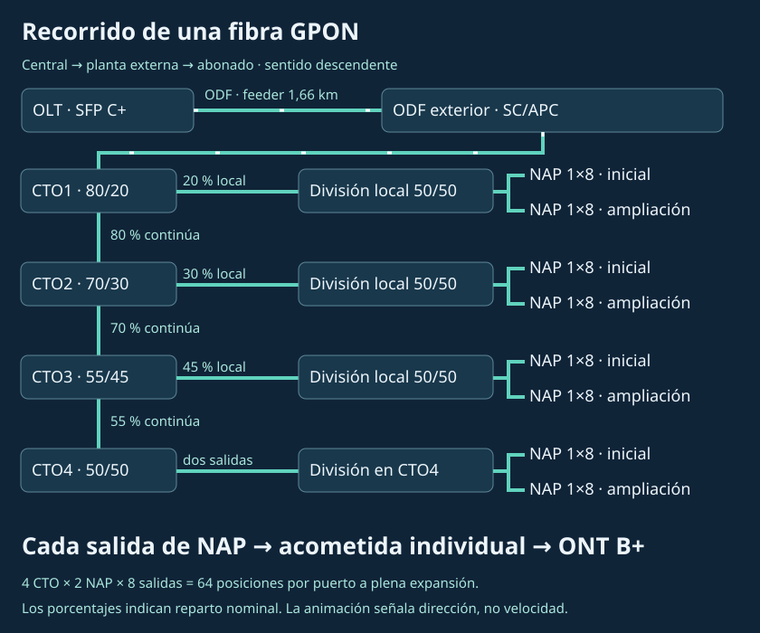
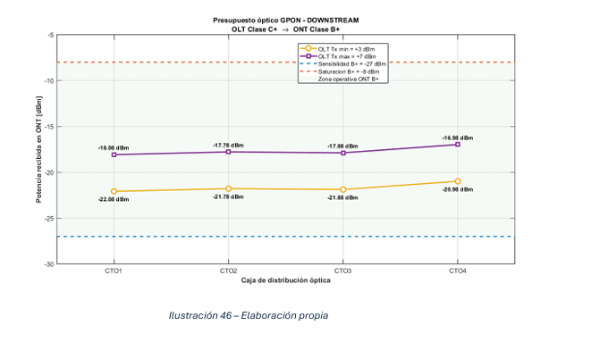
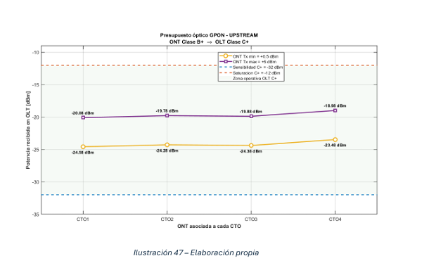

Proyecto académico de Nicolás Nahuel Fontana para Telefonía, Ingeniería Electrónica, UTN Facultad Regional Paraná.

En ocho manzanas se relevaron **223 viviendas y 23 comercios o galpones**. El diseño propone una planta externa subterránea para evitar aumentar la ocupación aérea. El recorrido de cada fibra permite estudiar cuánto derivar en cada esquina y qué potencia conservar para los abonados de las siguientes cajas.

[Arquitectura y equipamiento](#arquitectura) · [Cómo empezar el despliegue](#metodologia) · [Presupuesto óptico](#presupuesto-optico) · [Diseño subterráneo](#infraestructura-subterranea) · [Fuentes y recomendaciones](#referencias)

<h2 id="arquitectura">Arquitectura y equipamiento</h2>

| Tramo | Selección del TP y función |
|---|---|
| Central · OLT | TP-Link DS-P7001-08, ocho puertos GPON. Hasta cuatro se habilitan en el escenario final. Cada puerto activo utiliza un SFP TP-Link DS-PMA-C+ de clase C+. |
| ODN · alimentación | ODF interno de 19 pulgadas con terminación SC/UPC, feeder subterráneo de 12 fibras monomodo y 1,66 km, y segundo punto de distribución SC/APC. A plena cobertura quedan ocho fibras de reserva. |
| ODN · distribución | CTO con divisores 1×2 y cajas NAP independientes con PLC 1×8 y salidas SC/APC. La CTO organiza el reparto troncal/local; la NAP ofrece las salidas para acometidas. |
| Abonado · ONU/ONT | TP-Link XC220-G3v V2, terminal del abonado considerada clase B+ en el cálculo. ONU es el término general y ONT identifica aquí la terminación instalada en la vivienda o comercio. |

**ODN** (*Optical Distribution Network*) designa el conjunto pasivo entre OLT y ONT. La unidad de FTTH incluye distribuidores, cables, splitters, empalmes, conectores y elementos de planta externa (unidad, pp. PDF 128–131). El TP define los equipos concretos (pp. 29–39 y 68–71).

| CTO | Continuidad hacia la siguiente | Derivación |
|---|---:|---|
| 1 | 80 % | 20 % hacia 50/50 local |
| 2 | 70 % | 30 % hacia 50/50 local |
| 3 | 55 % | 45 % hacia 50/50 local |
| 4 | Fin de cascada | Un solo 50/50 terminal hacia las dos NAP |

Los porcentajes son fracciones nominales de la potencia incidente. En el balance se usa la pérdida de inserción real adoptada por salida. Así, aunque CTO4 está al final, su recorrido evita una etapa de derivación asimétrica local y tiene la potencia calculada más alta de los cuatro.

**Normas vinculadas.** L.250 orienta la elección topológica; G.984.1, las características generales GPON; G.984.2, la caracterización de las interfaces ópticas. IEC 60794-3-10 es la referencia de cable exterior citada por el TP, no un modelo comercial. [Fuentes y enlaces](#referencias).

Los porcentajes se aplican a la potencia que llega a cada divisor. En CTO3 sigue el 55 % hacia CTO4 y el 45 % alimenta la división local. La misma ODN transporta la subida en sentido inverso.

<h2 id="metodologia">Cómo empezar el despliegue</h2>

### 1. Partir del territorio y la demanda

El relevamiento visual de ocho manzanas en Paraná identificó acceso por cobre, HFC y fibra, además de ocupación de la infraestructura aérea. Se contaron 246 unidades potenciales. La selección de un trazado subterráneo responde a esas condiciones y a la posibilidad de reservar capacidad de canalización desde la primera obra. Fuentes: TP, §§ 1–2 y 4.1; [L.250 y G.984.1](#referencias).

### 2. Separar cobertura, puertos activos y altas

| Penetración supuesta | Abonados de diseño, redondeados hacia arriba | Mínimo de puertos a 64 abonados/puerto |
|---|---:|---:|
| 40 % | 99 | 2 |
| 70 % | 173 | 3 |
| 100 % | 246 | 4 |

Se aplica techo dos veces: primero a 246 × penetración y después al cociente entre abonados y 64. Es un dimensionamiento agregado. Cada sector debe disponer de salidas de NAP conectadas a los puertos activos donde se produzcan las altas. La relación 1:64 es una decisión del proyecto. El ancho de banda del puerto se comparte entre abonados (TP, pp. 25–30).

### 3. Diseñar para el escenario final y equipar por sector

Trazar primero los recorridos comunes y las derivaciones a grupos de viviendas. Reservar en los ductos espacio para crecimiento y en las cámaras acceso para empalmes. Elegir la rama de cada divisor y comprobar tanto sensibilidad como sobrecarga antes de fijar el recorrido. Las decisiones físicas y ópticas se revisan en conjunto: cambiar una CTO modifica el tendido y las pérdidas posteriores. [Infraestructura civil](#infraestructura-subterranea) · [Cálculos](#presupuesto-optico).

El TP prevé cuatro fibras activas a plena cobertura, 16 CTO y hasta 32 NAP de ocho salidas (256 posiciones). Los planos de penetración distinguen la NAP inicial de la segunda NAP de expansión. En el escenario de 40 %, dos puertos son el mínimo agregado. Para materializarlo hay que distribuir las NAP entre los sectores activos y habilitar suficientes ramas: con solo una NAP por CTO en dos cascadas habría 2 × 4 × 8 = 64 salidas para 99 altas. Los planos de cobertura y la asignación puerto–fibra–CTO–NAP permiten resolver esa secuencia sin confundir posiciones previstas con bocas disponibles. Fuente: TP, pp. 62–72.

### 4. Pasar del diseño a la obra

Como paso ejecutivo, contrastar el trazado con servicios existentes, permisos locales y condiciones de cada cruce. Dimensionar la canalización y proyectar reservas antes de abrir la vía. Después vendrían el tendido, la identificación de fibras y la aceptación óptica por trayecto. Estas son etapas propuestas; la evidencia experimental del proyecto se limita al alcance del relevamiento visual. [Referencias de planta externa](#referencias).

<h2 id="presupuesto-optico">Presupuesto óptico</h2>

**Método.** Para cada abonado se suman en dB las pérdidas de las ramas efectivamente atravesadas. Potencia recibida [dBm] = potencia transmitida [dBm] − pérdida del camino [dB]. El margen por sensibilidad es la potencia recibida mínima menos la sensibilidad. La holgura frente a sobrecarga es el umbral de sobrecarga menos la potencia recibida máxima. Marco de interfaces: [UIT-T G.984.2](#referencias). Método docente: unidad FTTH, «ODN – Cálculo de Enlace», p. PDF 120. Valores de diseño: TP final, pp. 42–56.

| Sentido | Transmisor mín. / máx. | Receptor | Sensibilidad / sobrecarga |
|---|---|---|---|
| Bajada | OLT C+, +3 / +7 dBm | ONT B+ | −27 / −8 dBm |
| Subida | ONT B+, +0,5 / +5 dBm | OLT C+ | −32 / −12 dBm |

El TP usa un coeficiente único de 0,35 dB/km en el feeder en ambos sentidos. El presupuesto no desglosa el coeficiente por longitud de onda. Se omiten las pequeñas longitudes individuales entre CTO. La reserva de diseño exigida es 3 dB; su comprobación en el modelo no sustituye la medición del enlace instalado.

### Pérdidas del modelo

| Elemento | Pérdida adoptada |
|---|---:|
| ODF en central y conexión/fusión del segundo punto | 1 + 1 dB |
| Feeder | 1,66 km × 0,35 dB/km ≈ 0,58 dB |
| Divisor 80/20, salidas 80 y 20 % | 1,3 / 7,4 dB |
| Divisor 70/30, salidas 70 y 30 % | 1,9 / 5,8 dB |
| Divisor 55/45, salidas 55 y 45 % | 3,1 / 4,0 dB |
| Salida 50/50, salida 1×8 y conexión final | 3,6 + 11 + 0,5 dB |

**Ejemplo CTO1:** 1 + 0,58 + 1 + 7,4 + 3,6 + 11 + 0,5 = 25,08 dB. En bajada mínima, +3 − 25,08 = −22,08 dBm. El margen de 4,92 dB supera por 1,92 dB la reserva requerida.

### Resultados recalculados con los supuestos del TP

| CTO | Pérdida (dB) | Bajada mín. / máx. (dBm) | Margen sensibilidad / sobrecarga (dB) | Subida mín. / máx. (dBm) | Margen sensibilidad / sobrecarga (dB) |
|---|---:|---|---|---|---|
| 1 | 25,08 | −22,08 / −18,08 | 4,92 / 10,08 | −24,58 / −20,08 | 7,42 / 8,08 |
| 2 | 24,78 | −21,78 / −17,78 | 5,22 / 9,78 | −24,28 / −19,78 | 7,72 / 7,78 |
| 3 | 24,88 | −21,88 / −17,88 | 5,12 / 9,88 | −24,38 / −19,88 | 7,62 / 7,88 |
| 4 | 23,98 | −20,98 / −16,98 | 6,02 / 8,98 | −23,48 / −18,98 | 8,52 / 6,98 |

**Trazabilidad de dos diferencias.** Para CTO3, el TP informa −24,3 dBm y 7,7 dB en subida mínima (pp. 52 y 54). Su propia suma da −21,8 − 1 − 0,58 − 1 = −24,38 dBm y 7,62 dB. Para CTO4, la p. 56 informa una holgura de 7,98 dB en subida máxima. Con los valores allí indicados, −12 − (−18,98) = 6,98 dB. Ambas correcciones conservan el cumplimiento del criterio académico de 3 dB. CTO1 condiciona la sensibilidad y CTO4 queda más cerca de la sobrecarga en ambos sentidos.

### Interpretación de las gráficas del presupuesto óptico

Cada punto representa el **nivel calculado en el receptor** para el recorrido asociado a una CTO. La curva con círculos corresponde a la potencia mínima de transmisión y la curva con cuadrados, a la máxima. La franja sombreada delimita la ventana del receptor. La separación vertical respecto de cada límite se expresa en dB.

#### Bajada · OLT C+ → ONT B+

Con la OLT a **+3 dBm**, la ONT asociada a **CTO1** recibe el nivel más bajo, **−22,08 dBm**. Queda **4,92 dB** por encima de la sensibilidad de −27 dBm. Al elevar la transmisión a **+7 dBm**, la curva sube 4 dB en todos los recorridos. El punto más próximo a la sobrecarga es la ONT de **CTO4**, con **−16,98 dBm**, todavía **8,98 dB** por debajo del límite de −8 dBm.

#### Subida · ONT B+ → OLT C+

En este sentido el receptor es siempre la **OLT**. El eje horizontal identifica desde qué rama transmite la ONT. A **+0,5 dBm**, la rama de **CTO1** entrega **−24,58 dBm** en la central y deja **7,42 dB** sobre la sensibilidad de −32 dBm. A **+5 dBm**, la rama de **CTO4** entrega el nivel más alto, **−18,98 dBm**, con **6,98 dB** de holgura frente a la sobrecarga de −12 dBm.

En ambas gráficas, CTO4 entrega más potencia que CTO1 pese a ocupar el último lugar de la cascada. La explicación está en los divisores que atraviesa cada recorrido: la pérdida total calculada baja de **25,08 dB** en CTO1 a **23,98 dB** en CTO4. Esa diferencia de **1,10 dB** también se observa entre los extremos de cada curva.

El TP utilizó MATLAB para representar estos niveles calculados (pp. 56–57).

<h2 id="infraestructura-subterranea">Diseño subterráneo</h2>

**Criterio de trazado.** El TP lleva la canalización principal por calles del área y sitúa cámaras principales cerca de intersecciones. Desde la vía pública se puede cambiar de dirección, derivar a otra calle y acceder a las CTO y reservas de cable. Separar los accesos comunes de los ingresos a cada propiedad facilita altas y reparaciones posteriores (TP, pp. 57–61).

| Nivel físico | Función en el diseño | Referencia asociada |
|---|---|---|
| Canalización principal | Aloja feeder y distribución. La obra común se proyecta con reserva para ampliación. | L.205: planos y disposición de ductos. L.155: alternativa de zanja de bajo impacto. |
| Cámara principal | Punto de tendido, giro, empalme y distribución próximo a la esquina. | L.258: procedimientos de seguridad en instalaciones exteriores. |
| Microducto y cámara secundaria | Derivación hacia grupos de viviendas; se propone como criterio una cámara secundaria por par de viviendas próximas. | L.205: documentación del trazado. L.259: inspección y reparación de conductos plásticos. |
| Acometida | Desde cámara secundaria al límite de propiedad; el cable drop ingresa hasta la ONT. | L.250: relación entre distribución y acceso final. TP § 4.6.4: solución del proyecto. |

**Cantidades de anteproyecto** (TP, p. 72): 29 cámaras principales, 112 secundarias, 5.000 m de ducto principal, 560 m de microductos y 32 pilares. El TP estima los microductos como 112 × 5 m. La longitud del ducto para toda el área y la del feeder de 1,66 km describen magnitudes distintas.

La microzanja es una técnica de referencia. La selección de método y dimensiones por tramo exige replanteo, identificación de interferencias y condiciones municipales. El plano del TP es una propuesta de infraestructura. [Índice normativo](#referencias).

<h2 id="referencias">Fuentes y recomendaciones</h2>

**Fuente primaria:** Nicolás Nahuel Fontana, *Red de acceso telefónica*, TP N.º 1 de Telefonía, Ingeniería Electrónica, UTN Facultad Regional Paraná. Versión utilizada: `TPN1_RelevamientoRed_FontanaNicolas_2026.pdf`. Relevamiento y demanda: pp. 6–28. Equipos y topología: pp. 29–41 y 68–71. Cálculos: pp. 42–56. Planta subterránea y penetración: pp. 57–66 y 72.

**Material docente:** *Unidad 4 – FTTH*, archivo `Unida Redes FFTH.pdf`. La p. 120 del PDF (lámina 122) introduce el cálculo de enlace; pp. 128–131 del PDF (láminas 130–133) presentan la ODN y sus componentes. Se utiliza para ordenar conceptos y funciones. Las cantidades y los resultados numéricos proceden del TP.

| Referencia | Aplicación en el proyecto |
|---|---|
| [UIT-T L.250](https://www.itu.int/rec/T-REC-L.250/en) | Topologías de acceso óptico. Contexto del reparto en cascada. |
| [UIT-T G.984.1](https://www.itu.int/rec/T-REC-G.984.1/en) | Características generales de GPON. Contexto de la relación OLT–ODN–ONT. |
| [UIT-T G.984.2](https://www.itu.int/rec/T-REC-G.984.2/en) | Capa dependiente del medio físico. Referencia para potencias de emisión y recepción. |
| IEC 60794-3-10 | Familia de cables ópticos exteriores citada en el TP, p. 34. |
| [UIT-T L.155](https://www.itu.int/rec/T-REC-L.155/en) | Técnicas de zanja de bajo impacto para FTTx. |
| [UIT-T L.205](https://www.itu.int/rec/T-REC-L.205/en) (antes L.11) | Planos de canalización y uso compartido de túneles. |
| [UIT-T L.258](https://www.itu.int/rec/T-REC-L.258/en) (antes L.63) | Seguridad en instalaciones exteriores. |
| [UIT-T L.259](https://www.itu.int/rec/T-REC-L.259/en) (antes L.73) | Inspección y reparación de conductos plásticos enterrados. |

Las recomendaciones aportan criterios de ingeniería. La relación 1:64, la reserva de 3 dB, los porcentajes de cada divisor y la cantidad de cámaras son decisiones de este proyecto.

[Repositorio técnico](https://github.com/NicolasFontana-creator/ftth-gpon-network-design) · [English project overview](https://github.com/NicolasFontana-creator/ftth-gpon-network-design/blob/main/README.en.md)
