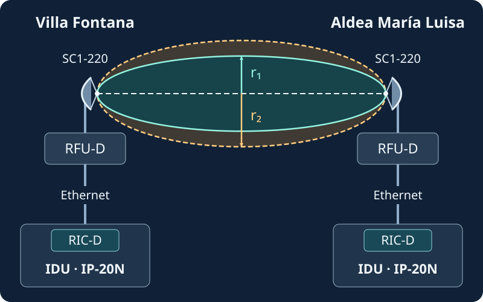
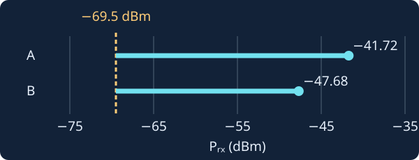

**Nicolás Fontana y Juan Andrés Terlin** · Equipos de Microondas · Ingeniería Electrónica, UTN Facultad Regional Paraná · 2026.

## Problema y objetivos

¿Puede un salto de **5,88 km** transportar **155 Mbit/s** entre Villa Fontana y Aldea María Luisa con arboledas en el trayecto? El proyecto estudia dónde ubicar las antenas en altura, qué modulación satisface la capacidad requerida y cuánto margen queda frente a las pérdidas de propagación. Los autores reconocieron físicamente los emplazamientos. Las potencias, los márgenes y la disponibilidad proceden de modelos de diseño.

## Del relevamiento al perfil

El recorrido de campo, la carta IGN *General Racedo* a escala 1:50.000 y Google Earth permitieron identificar cambios de cota, cursos de agua y vegetación. La planilla informa azimuts de **66° 24′ 02″** desde Villa Fontana y **246° 22′ 13″** en sentido inverso. Las alturas de antena adoptadas fueron **23 m y 12 m** sobre terreno, respectivamente (TP, pp. 3–18).

En el obstáculo a 2,44 km se estimaron árboles de 20 m. El TP compara la recta del haz con el terreno, la vegetación y la curvatura terrestre para factores de radio efectivo **k = 4/3 y k = 2/3**. Informa radios de **4,4 m** y **6,22 m** para la primera y segunda zonas de Fresnel. El anexo utiliza **6,15 km y 23 GHz** en esas ecuaciones y parte de **25 m** en el extremo sur para deducir la otra altura. Por esa diferencia con el perfil adoptado, el despejamiento definitivo queda pendiente de conciliación (pp. 16–18 y 41–43).

## Arquitectura y equipamiento

En ambos extremos, la unidad interior **Ceragon FibeAir IP‑20N** se conecta mediante la tarjeta **RIC‑D** a la unidad exterior **RFU‑D**. El tramo interior–exterior transporta datos digitales. La RFU realiza la modulación y se acopla a la antena **RFS SC1‑220**, de **0,30 m**, con ganancia adoptada de **35,5 dBi** por extremo. El presupuesto supone montaje directo. La compatibilidad mecánica definitiva depende de la variante de antena y del adaptador (pp. 34–38 y 43–51).

Leé el esquema desde la IDU de Villa Fontana hasta la IDU de Aldea María Luisa. La tarjeta RIC-D conecta cada nodo de acceso por Ethernet con su RFU-D. Entre las antenas SC1-220, la línea discontinua indica la línea de vista. Las flechas r₁ y r₂ indican los radios hasta los límites de la primera y segunda zona de Fresnel en el centro del salto. Es un esquema conceptual sin escala.

Para la interconexión se proyectaron **35 m de cable de cobre por estación**, con fibra como alternativa. Las pérdidas del cable de datos se evalúan por separado del trayecto radioeléctrico. Los planos estudian shelter, gabinete exterior, rack y puesta a tierra como alternativas de instalación (pp. 23–38 y 51–56).

## Canal y presupuesto de enlace

El par académico **21,462 / 22,694 GHz** tiene **1.232 MHz** de separación dúplex. El diseño utiliza el canal 9 de **28 MHz** según el arreglo estudiado en UIT‑R F.637‑5. La tabla 7 atribuye a **128‑QAM** una capacidad de **167–205 Mbit/s**. El balance adopta **22 dBm** de transmisión y **−69,5 dBm** de sensibilidad para BER 10⁻⁶ (pp. 19, 22 y 43–49).

**A · Cálculo analítico.** A la frecuencia media de 22,078 GHz, la pérdida de espacio libre es **134,72 dB**. La suma de potencia y ganancias menos esa pérdida da **22 + 35,5 + 35,5 − 134,72 = −41,72 dBm**. La diferencia respecto de la sensibilidad es **27,78 dB** (p. 19).

**B · Plantilla final.** La planilla adopta **6,02 dB por obstrucción**, reporta **−47,68 dBm** en recepción y **21,82 dB** de margen. La figura reconstruye ambos resultados a partir de las pp. 19 y 22. La plantilla sitúa un obstáculo a 0,30 km mientras que la tabla del relevamiento registra el primero a 0,03 km. Falta conciliar ambos puntos para atribuir físicamente esa pérdida.

## Conclusiones y alcance

El estado de modulación seleccionado cubre la capacidad objetivo en la tabla del informe. La obstrucción reduce el margen disponible en la plantilla. Para lluvia, el desarrollo analítico estima **24,46 dB** excedidos el **0,01 %** del tiempo. La plantilla usa otros coeficientes y reporta **0,126476 %** de tiempo excedido total antes de la mejora por diversidad. La unidad de la probabilidad empleada en el cálculo analítico de disponibilidad también requiere revisión. Por eso el **99,99 %** se conserva como objetivo de diseño. El trabajo documenta un relevamiento y una instalación propuesta, sin registros de puesta en servicio (pp. 19–23 y 39).

**Fuente:** Fontana y Terlin, *Diseño de un Radio Enlace*, TP integrador de Equipos de Microondas, UTN FR Paraná, 2026.
