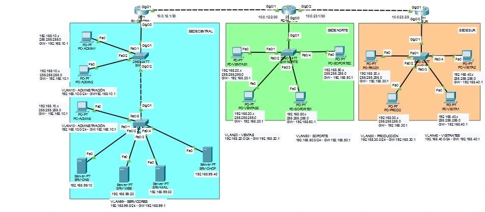

**Nicolás Fontana · Nicolás Molo · Malena Silvestre** · Técnicas Digitales III · UTN Facultad Regional Paraná · 2026.

## El problema de diseño

Cada departamento de Andes S.A. necesita su propia red, pero las tres oficinas comparten los servidores de Central. En Cisco Packet Tracer se construyó una topología lineal con tres routers Cisco 2911, cuatro switches 2960, once PC y cuatro servidores. El tráfico entre Central y Sur pasa por Norte.

Captura del informe de redes, p. 5, con la anotación de acceso retirada.

## Del puerto de acceso a la aplicación

Los puertos de acceso separan Administración, Ventas, Soporte, Producción, Visitantes y Servidores. Los troncales 802.1Q transportan las VLAN de cada sede hasta las subinterfaces del router local. OSPFv2 en área 0 comunica las seis subredes y los dos enlaces de tránsito. DHCP Relay permite usar un único servidor DHCP para las cinco VLAN de usuarios. DNS, HTTP, SMTP y POP3 se alojan en la VLAN de servidores.

## Verificación y recuperación

El equipo contrastó las VLAN y troncales con las tablas de rutas y los vecinos OSPF antes de probar conectividad, web y correo. En Simulation Mode siguió la asignación DHCP y la secuencia DNS–TCP–HTTP. Al detener DHCP, un cliente nuevo perdió la posibilidad de obtener una concesión; al alterar un registro A, DNS respondió con un destino incorrecto. El informe muestra la restitución de ambos servicios (pp. 20–40). Los resultados corresponden al escenario simulado.
