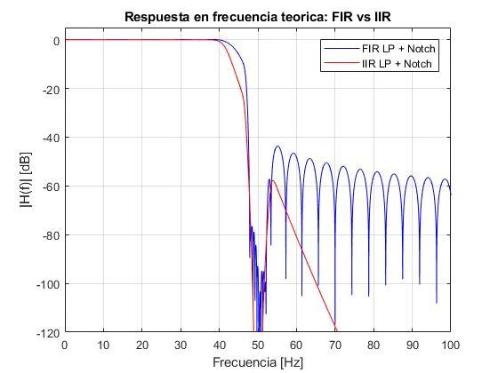
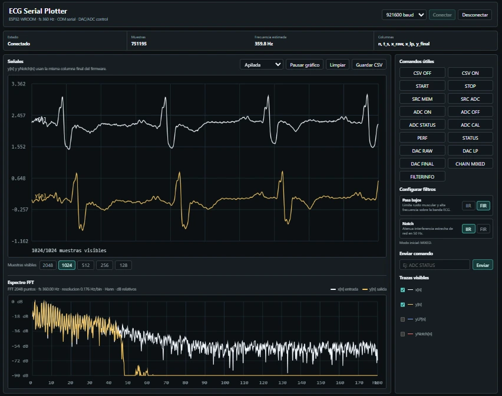

**Nicolás Fontana · Nicolás Molo · Malena Silvestre** · Técnicas Digitales III · UTN Facultad Regional Paraná · 2026.

## Qué se comparó

Para reducir ruido de alta frecuencia e interferencia de red, el equipo aplicó dos cascadas al registro 118e00 de MIT-BIH Noise Stress Test Database a 360 muestras/s. En MATLAB comparó un pasa bajos Kaiser y un rechaza banda Hamming con sus alternativas IIR Butterworth. Las pruebas incluyeron respuesta al impulso, fase, retardo de grupo y FFT de la señal.

Figura 26, informe integrador, p. 42. La curva representa la transferencia teórica. El cambio en la FFT de un registro finito es otra magnitud.

## Resultado y compromiso de diseño

Los FIR simétricos conservan fase lineal. Los órdenes 81 y 720 implican 400,5 muestras de retardo total, equivalentes a 1,1125 s. El informe encuentra menor RMSE con FIR en este ensayo y menor costo computacional con IIR. La documentación técnica identifica la discrepancia entre el ejemplo IIR de segundo orden y el diseño final de orden 22.

## Del modelo al banco de pruebas

Un sistema experto de reglas pondera fase, memoria, ruido y latencia. La prueba con ESP32 combina un pasa bajos FIR con un notch IIR. La WebApp recibe muestras por Web Serial y muestra el registro reproducido desde memoria y su espectro. El informe también documenta una prueba con senoide en el ADC. Las evidencias corresponden a simulación y banco de laboratorio.

Figura 33, p. 61. Fuente de los resultados: informe integrador, pp. 31–61.
